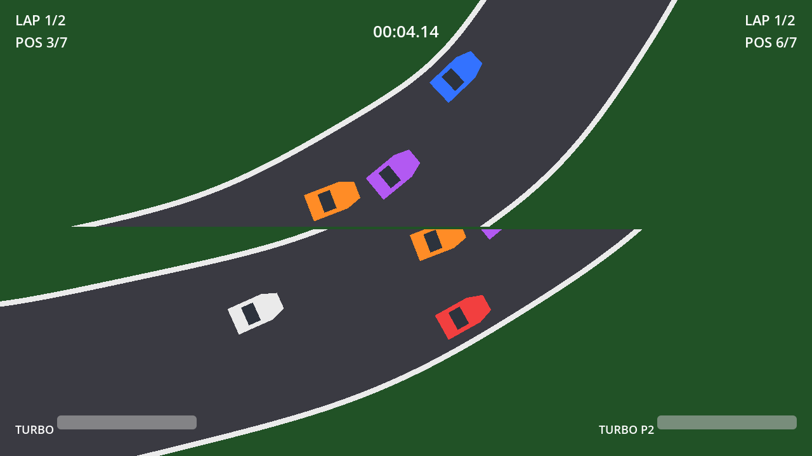

# Split-Race

**Balapan 2D top-down arcade untuk 1–2 pemain di satu keyboard.**




## Tentang

Split-Race adalah game balapan 2D bergaya arcade dengan perspektif top-down. Satu race
berisi 7 mobil: pemain melawan CPU, atau dua pemain berbagi keyboard yang sama dengan
tampilan split-screen. Menyelesaikan lap sebanyak yang dipilih akan menghasilkan ranking,
waktu tiap lap, dan best lap.

## Fitur

- **Single Player** — 1 pemain melawan 6 mobil CPU.
- **Local Multiplayer** — 2 pemain split-screen melawan 5 mobil CPU.
- **7 mobil** dengan warna berbeda dan collision antar mobil.
- **Turbo** dengan meter yang terkuras saat dipakai dan terisi kembali.
- **Pilihan 2 atau 3 lap**, serta 3 tingkat kesulitan CPU (Easy / Normal / Hard).
- **Ranking real-time**, HUD lap/posisi/turbo per pemain.
- **Layar hasil** berisi ranking akhir, waktu finish, waktu per lap, dan best lap.
- **Pause** (Esc), **Play Again**, dan kembali ke Home.

## Kontrol

| Aksi          | Player 1 | Player 2 |
| ------------- | -------- | -------- |
| Arah / gas    | W A S D  | I J K L  |
| Rem           | Q        | O        |
| Turbo         | E        | U        |
| Pause         | Esc      | Esc      |

Tidak ada tombol gas terpisah: menekan arah langsung memutar dan menggerakkan mobil
(8 arah, termasuk diagonal). Lepas semua tombol arah untuk meluncur dan melambat.

## Menjalankan

Kebutuhan: **Godot 4.7.x** (Standard, bukan .NET) dengan renderer **GL Compatibility**.
Diuji dengan Godot 4.7.2 stable.

```bash
git clone https://github.com/kalyzet/split-race.git
cd split-race
```

1. Buka Godot, pilih **Import**, lalu arahkan ke `project.godot`.
2. Tekan **F5** untuk menjalankan game.

Atau lewat command line (Windows):

```powershell
D:\Downloads\Godot_v4.7.2-stable_win64.exe\Godot_v4.7.2-stable_win64_console.exe --path D:\Koding\Dekstop\splitrace
```

Jika `godot` sudah ada di `PATH`, bisa juga:

```bash
godot --path .
```

## Struktur Proyek

```text
scenes/          Menu, race setup, race, results, HUD, mobil, lintasan
scripts/
  autoload/      GameManager (mode, lap, difficulty, hasil race)
  car/           Fisika mobil, kontrol pemain, AI CPU
  race/          Manajer race, lintasan, checkpoint, kamera
  ui/            Menu, setup, HUD, results
tests/           Probe headless untuk regresi
docs/            Screenshot
MVP.md           Spesifikasi lengkap dan keputusan implementasi
project.godot    Konfigurasi proyek dan Input Map
```

## Pengujian

Semua probe dapat dijalankan headless tanpa membuka jendela:

```bash
# Race penuh: 7 mobil finish, pindah ke layar hasil
godot --headless --path . res://tests/full_race_probe.tscn

# Fisika: gesek dinding dan tabrakan head-on
godot --headless --path . res://tests/physics_probe.tscn

# Multiplayer: world sharing, split-screen, kamera, layar hasil
godot --headless --path . res://tests/race_probe.tscn

# Layout viewport dan HUD
godot --headless --path . res://tests/render_probe.tscn

# Tombol Play Again dan Home di layar hasil
godot --headless --path . res://tests/results_buttons_probe.tscn
```

## Alur Permainan

```text
Home -> Pilih Mode -> Race Setup -> Race -> Results -> Home / Play Again
```

## Dokumentasi

Aturan permainan, arsitektur, kontrol, dan keputusan implementasi dijelaskan lengkap di
[MVP.md](MVP.md).

## Status

MVP selesai dan dapat dimainkan: kedua mode, turbo, tabrakan, ranking, hasil akhir, dan
seluruh alur menu sudah berfungsi.
